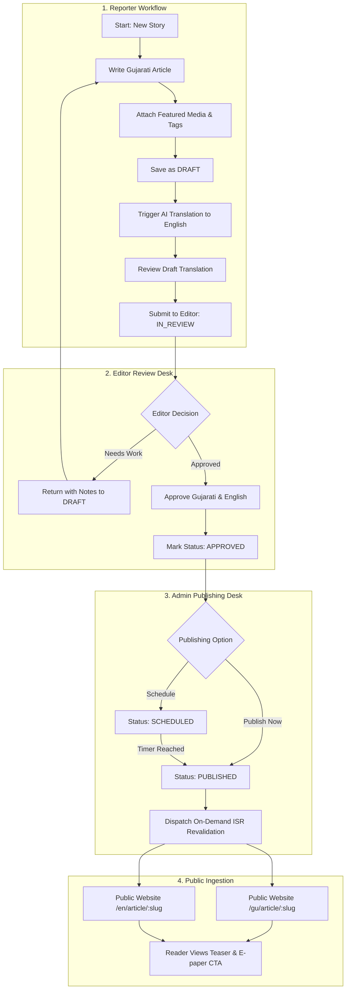
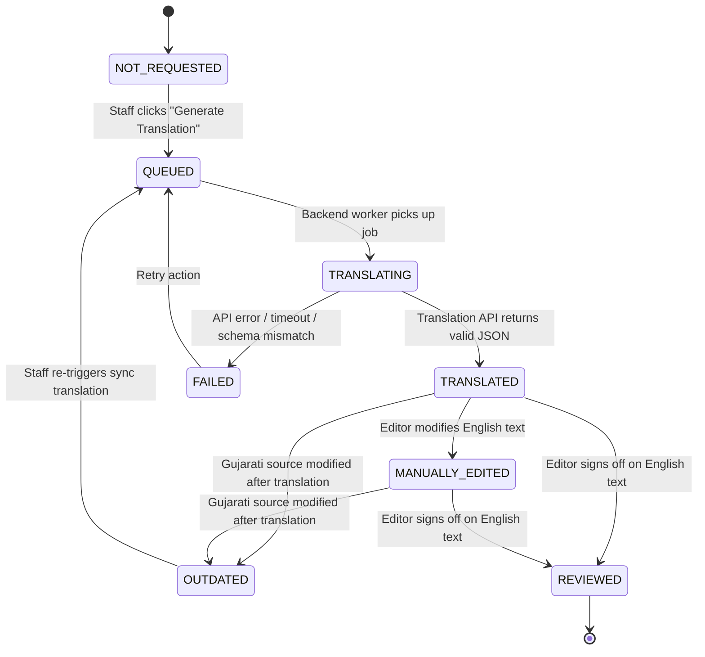
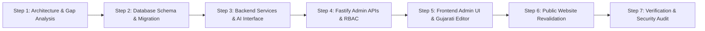

# JANMABHOOMI DIGITAL NEWSPAPER PLATFORM
# PHASE 5 — COMPLETE NEWSROOM SYSTEM ARCHITECTURE & GAP ANALYSIS
### Master Design Specification & Implementation Blueprint

---

## EXECUTIVE SUMMARY & STATUS

- **Task Scope:** Phase 5 Step 1 — Architecture Discovery, Codebase Inspection, Gap Analysis, and Master Architecture Specification.
- **Mode:** **Inspection-Only** (No source code edits, no schema alterations, no migrations, no package installations, no external AI calls, no deployments).
- **Core Platform Scope:** Exactly **TWO** newspaper publications:
  1. `pub-janmabhoomi` — **Janmabhoomi** (Daily Evening Newspaper, est. 9 June 1934)
  2. `pub-pravasi` — **Janmabhoomi Pravasi** (Sunday Weekly Family Edition Newspaper, est. 22 Oct 1939)
- **Purti Ecosystem:** *Purti* (પૂર્તિ — Madhuvan, Meghdhanush, Madhurima) is **NOT** an independent publication entity; it is a bundled magazine supplement attached directly to specific newspaper editions.
- **Previous Phases Status:**
  - **Phase 1 (Foundation):** Fully functional, healthy.
  - **Phase 2 (Database & PostgreSQL Migration):** Live on Docker PostgreSQL 16 `janmabhoomi_dev`.
  - **Phase 3 (E-Paper System):** Full edition processing, multi-res tiling, interactive page hotspots.
  - **Phase 4 (Razorpay & Subscriber Auth):** Hardened, persistent sessions, webhook signatures verified.
  - **Phase 5A (Unified Admin Panel Foundation):** Verified with 97/97 tests passing (`test-phase5a-admin.ts`), strict 2-role staff RBAC (`Admin` vs `Editor`), hardened E-paper permissions.

---

## 1. CURRENT ARCHITECTURE & EXISTING CAPABILITIES

### 1.1 Technology Stack Overview
- **Frontend:** Next.js 15 (App Router), React 19, TypeScript, Tailwind CSS v4, Lucide React icons.
- **Backend:** Fastify 5, TypeScript, Node.js 20+ runtime.
- **Database & ORM:** PostgreSQL 16 (running via Docker container `janmabhoomi-postgres` on port 5432), Prisma ORM 6.
- **Authentication Subsystems:**
  1. *Newsroom Staff Authentication:* Argon2id password hashing, persistent 24-hour bearer tokens (`stf_*` hashed with SHA-256 in `staff_sessions`), RBAC via `roles` and `user_roles`.
  2. *Subscriber Authentication:* Argon2id password hashing, persistent 30-day tokens (`sub_*` hashed with SHA-256 in `subscriber_sessions`), Razorpay subscription management.
- **Storage Subsystem:** Pluggable local file storage provider (`backend/src/storage/storageProvider.ts`) with dedicated directories for E-paper high-res pages, thumbnails, and PDF source files.

### 1.2 Existing Database Models (`backend/prisma/schema.prisma`)
The existing schema already possesses strong foundations for newspaper operations:
- **Tenancy & Taxonomy:** `Publication`, `Category`, `PublicationCategory`, `Author`, `Tag`, `ArticleTag`.
- **Content:**
  - `Article`: Has `publicationId`, `categoryId`, `authorId`, `status` (`ArticleStatus`: `DRAFT`, `UNDER_REVIEW`, `APPROVED`, `SCHEDULED`, `PUBLISHED`, `ARCHIVED`), `isBreaking`, `isLeadStory`, `isSubLead`, `isHeadlineBrief`, `isPaywalled`, `epaperPageNumber`, `featuredImageUrl`, `publishedAt`, `scheduledFor`, `viewCount`, `createdBy`.
  - `ArticleTranslation`: Keyed by `(articleId, language)` with `language` (`gu`, `en`), `slug`, `headline`, `summary`, `teaserParagraphs` (JSON), `contentHtml`, `metaTitle`, `metaDescription`, `readTimeMinutes`.
  - `Editorial`: Publication-dated lead editorials (`slugEn`, `slugGu`, `titleEn`, `titleGu`, `contentEn`, `contentGu`, `epaperPageNumber`).
  - `PanchangDaily`: Astronomical tithi, nakshatra, sunrise/sunset, and rahu kaal for Mumbai, Ahmedabad, and Rajkot.
- **E-paper & Hotspots:** `EPaperEdition` (status tracking: `DRAFT`, `UPLOADED`, `PROCESSING`, `READY`, `PUBLISHED`, `FAILED`, `ARCHIVED`), `EPaperPage`, `EPaperHotspot` (bounding box coordinates linking pages to online articles or external links).
- **Staff & Security:** `User` (`isStaff: true`), `StaffSession`, `Role`, `Permission`, `RolePermission`, `UserRole`, `AuditLog`.
- **Subscribers & Payments:** `Subscriber`, `SubscriberSession`, `SubscriptionPlan`, `UserSubscription`, `RazorpayOrder`, `PaymentTransaction`, `PaymentWebhookLog`, `ArchiveEnquiry`, `ContactEnquiry`, `Advertisement`.

### 1.3 Existing Backend Routes
- **Public News APIs (`backend/src/routes/content.ts`):**
  - `GET /api/v1/publications`
  - `GET /api/v1/categories`
  - `GET /api/v1/articles/home?lang=...&publication=...`
  - `GET /api/v1/articles/latest?page=...&limit=...`
  - `GET /api/v1/articles/:slug?lang=...`
  - `GET /api/v1/editorials/today`
  - `GET /api/v1/editorials/archive`
  - `GET /api/v1/panchang/:date`
- **Admin APIs (`backend/src/routes/`):**
  - `POST /api/v1/admin/auth/login`, `POST /api/v1/admin/auth/logout`, `GET /api/v1/admin/auth/me`
  - `GET /api/v1/admin/staff`, `POST /api/v1/admin/staff`, `PUT /api/v1/admin/staff/:id/role`, `PUT /api/v1/admin/staff/:id/status`
  - `GET /api/v1/admin/dashboard/stats`, `GET /api/v1/admin/dashboard/publications`
  - `GET /api/v1/admin/payments/overview`, `GET /api/v1/admin/payments/transactions`, `GET /api/v1/admin/payments/subscribers`
  - `GET /api/v1/epaper/admin/editions`, `POST /api/v1/epaper/admin/editions`, `PUT /api/v1/epaper/admin/editions/:id/status`, `POST /api/v1/epaper/admin/editions/:id/pages`, `POST /api/v1/epaper/admin/pages/:pageId/hotspots`.

### 1.4 Existing Frontend State
- **Public App Router:** Dynamic bilingual routing under `src/app/[lang]/` (`en` and `gu`).
- **Data Layer:** `INewsDataProvider` contract implemented by `ApiNewsDataProvider` (points to Fastify backend) and `MockNewsDataProvider` (offline fallback).
- **Admin Panel UI:** Located at `src/app/[lang]/admin/`:
  - Working modules: Login, Dashboard, Staff Management, Publications Catalog, E-paper Edition Manager, Payment & Subscriber Oversight.
  - Placeholder modules: `articles/page.tsx`, `editorials/page.tsx`, `audit/page.tsx`, `settings/page.tsx`.

---

## 2. MISSING CAPABILITIES & IDENTIFIED GAPS

```
+--------------------------------------------------------------------------------------------------+
|                                     PHASE 5 GAP ANALYSIS                                         |
+--------------------------------------------------------------------------------------------------+
| Capability Area         | Current State                     | Required Phase 5 State             |
+-------------------------+-----------------------------------+------------------------------------+
| Article Authoring       | Placeholder UI                    | Full Gujarati-first WYSIWYG editor |
| AI Translation Engine   | Non-existent                      | Auto Gujarati->English with sync   |
| Translation Sync Tracking| Translations detached from sync   | Versioning, hash, outdated status  |
| Editorial Workflow Desk | No review UI or API approval      | Reporter->Editor->Admin state flow |
| Media Library           | Direct image URLs only            | Centralized asset storage & search |
| Category Management     | Read-only API & fixed seed        | Admin CRUD & navigation ordering   |
| Supplement Handling     | Pages mixed in edition            | Supplement tags (Madhuvan, etc.)   |
| Public Revalidation     | Manual page refresh               | On-demand Next.js ISR revalidation |
| Audit Trail Coverage    | Schema exists, but news not logged| Every news draft/publish audited   |
+-------------------------+-----------------------------------+------------------------------------+
```

### 2.1 Specific Gap Breakdown
1. **Absence of News Admin APIs (`backend/src/routes/adminArticles.ts`):**
   There are no staff-authenticated endpoints to create, update, delete, submit, approve, schedule, or publish articles.
2. **Missing Translation Metadata in Database:**
   `ArticleTranslation` has no fields to indicate whether a translation was generated by AI, which model was used, whether it is in draft or approved state, or if the source Gujarati article has since been edited (making the English version outdated).
3. **No Centralized Media Library Asset Table:**
   Images are currently referenced only as raw string URLs (`featuredImageUrl`). There is no table for uploaded assets, dimensions, MIME types, Gujarati/English alt captions, photographer credits, or re-usability across articles.
4. **No Supplement Differentiation on E-Paper Pages:**
   `EPaperPage` records have no designation for whether a page belongs to the main broadsheet or a Purti supplement (e.g. *Madhuvan*, *Meghdhanush*, *Madhurima*).
5. **Frontend Authoring UI Missing:**
   The admin interface for `/admin/articles` is merely a placeholder component without rich text editing, Gujarati typography support, media embedding, or side-by-side translation review.
6. **No On-Demand Cache Invalidation:**
   When an article is published or updated in the Fastify backend, Next.js ISR caches on the public frontend are not automatically notified or purged.

---

## 3. COMPLETE PHASE 5 MODULE LIST

Phase 5 delivers eleven integrated modules forming the production newsroom operating system:

1. **News Management Module:** Article listing, multi-filter search (by publication, category, status, author, date), pagination, bulk status changes, breaking news toggles.
2. **Gujarati-First Authoring Module:** Rich text Gujarati editing, Gujarati virtual keyboard / transliteration assistance, headline brief formatting, lead/sub-lead placement.
3. **AI-Assisted Translation Engine:** Asynchronous translation micro-pipeline translating Gujarati headline, summary, teaser paragraphs, and content into natural, culturally accurate English.
4. **Translation Review & Editorial Desk:** Side-by-side split screen UI displaying source Gujarati alongside editable English translation, diff highlighting, and sync warnings.
5. **Editorial Approval & Publishing Workflow:** Strict state machine enforcing Reporter submission, Editor verification, and Admin publication rights.
6. **Taxonomy & Category Management Desk:** Category hierarchy management, display order adjustments, and publication-specific navigation visibility toggles.
7. **Unified Media Library & Asset Manager:** Multi-file drag-and-drop upload, image optimization, automatic thumbnail generation, bilingual alt text, photographer credits, and media picker modal.
8. **E-Paper & Purti Supplement Management:** Attachment of named supplements (*Madhuvan*, *Meghdhanush*, *Madhurima*) to editions, page-level supplement tagging, and hotspot linking to published web articles.
9. **Staff RBAC & Newsroom Desk Permissions:** Strict enforcement of `Admin`, `Editor`, and `Reporter` roles on all backend endpoints and UI actions.
10. **Public Website Integration & Revalidation:** Automatic on-demand Next.js cache purging upon article publish, bilingual canonical link handling, and paywalled teaser gating.
11. **Immutable Audit Logging & Compliance Ledger:** Complete tracking of all editorial modifications, status transitions, translation requests, and publishing actions.

---

## 4. PROPOSED USER WORKFLOWS & EDITORIAL LIFECYCLES

### 4.1 Editorial Pipeline Diagram



### 4.2 Step-by-Step Role Operations
1. **Reporter:**
   - Logs into the Admin Panel.
   - Selects Publication (`pub-janmabhoomi` or `pub-pravasi`) and Category.
   - Drafts article in Gujarati (headline, summary, body).
   - Selects or uploads featured image from the Media Library.
   - Clicks "Generate English Translation" (queues AI translation).
   - Verifies the English translation; refines if necessary.
   - Clicks "Submit for Review". Article status changes from `DRAFT` to `IN_REVIEW`.
2. **Editor:**
   - Filters Newsroom queue for `IN_REVIEW` articles.
   - Performs bilingual editorial review (checks Gujarati journalistic standards, accuracy of English translation, category, and paywall flags).
   - Can edit both Gujarati and English versions directly.
   - Either sends back to Reporter (`DRAFT` with editorial comment) or marks `APPROVED`.
   - Editors can also publish directly if granted express editorial publishing authority.
3. **Administrator:**
   - Final authority over breaking news alerts (`isBreaking`), homepage lead story designation (`isLeadStory`), and scheduling (`SCHEDULED`).
   - Executes immediate publishing (`PUBLISHED`) or schedules publication for a specific timestamp.
   - Oversees category taxonomy and manages staff role assignments.
4. **Public Reader:**
   - Accesses article via bilingual route (`/gu/article/[slug]` or `/en/article/[slug]`).
   - Reads headline, summary, and public teaser paragraphs.
   - Sees newspaper provenance (Page number and Edition date).
   - Prompted by subscription CTA to read full facsimile or complete issue in the E-Paper.

---

## 5. GUJARATI-TO-ENGLISH AI TRANSLATION ENGINE SPECIFICATION

### 5.1 Translation State Machine
Every article maintains a translation lifecycle tracked independently of the main publishing status:



### 5.2 Version Tracking & Stale Translation Detection
To prevent the English website from displaying outdated content when a Gujarati breaking story is updated:
1. `sourceLanguageVersion` (Integer) increments on the `Article` record every time Gujarati content is saved.
2. `ArticleTranslation` stores `sourceVersionAtTranslation` (Integer) and `translationSourceHash` (SHA-256 hash of Gujarati headline + summary + body).
3. If `Article.sourceLanguageVersion > ArticleTranslation.sourceVersionAtTranslation`, the backend automatically marks `translationStatus = OUTDATED`.
4. The Admin UI renders an amber warning banner: *"Gujarati source has been updated since this translation was generated. Review or re-sync translation."*

### 5.3 Reliability, Retry Policy & Rate Limiting
- **Timeout:** Fastify timeout for translation calls set to 25 seconds.
- **Retry Mechanism:** 3 attempts with exponential backoff (1s, 2s, 4s) on HTTP 429 or 5xx responses.
- **Credential Isolation:** AI API keys must reside exclusively in backend environment variables (`AI_TRANSLATION_API_KEY`). They are never exposed to the frontend browser or logged in audit records.
- **Rate-Limiting:** Maximum 10 translation requests per staff user per 5-minute window to avoid abuse or unexpected token consumption.

### 5.4 Stylistic & Cultural Nuance Requirements
The translation system must adhere to specific journalistic rules for Saurashtra Trust publications:
- Proper nouns (e.g. Gujarati names, Gujarat geographical locations like *Saurashtra*, *Kathiawad*, *Amreli*, *Junagadh*) must use standardized English transliterations rather than literal dictionary translations.
- Idiomatic Gujarati political phrases must be translated into journalistic English while preserving context.
- Respectful honorifics (*Shri*, *Smt.*) must be preserved.

---

## 6. PROPOSED DATABASE SCHEMA CHANGES (ADDITIVE ONLY)

All schema changes for Phase 5 are strictly additive. Existing columns, primary keys, and relationships remain intact to ensure 100% backward compatibility with Phases 1 through 5A.

### 6.1 Enhancements to Existing Models

#### Additions to `model Article`:
```prisma
// ADDITIVE FIELDS FOR PHASE 5
primaryLanguage       String    @default("gu") @map("primary_language") @db.VarChar(10)
sourceLanguageVersion Int       @default(1) @map("source_language_version")
isEditorialPick       Boolean   @default(false) @map("is_editorial_pick")
featuredMediaId       String?   @map("featured_media_id") @db.Uuid
```

#### Additions to `model ArticleTranslation`:
```prisma
// ADDITIVE FIELDS FOR PHASE 5 TRANSLATION PIPELINE
translationStatus          String    @default("ORIGINAL") @map("translation_status") @db.VarChar(30)
// Values: 'ORIGINAL', 'NOT_REQUESTED', 'QUEUED', 'TRANSLATING', 'TRANSLATED', 'OUTDATED', 'MANUALLY_EDITED', 'REVIEWED', 'FAILED'
translationSourceHash      String?   @map("translation_source_hash") @db.VarChar(64)
sourceVersionAtTranslation Int?      @map("source_version_at_translation")
aiProvider                 String?   @map("ai_provider") @db.VarChar(50)
aiModel                    String?   @map("ai_model") @db.VarChar(50)
translatedAt               DateTime? @map("translated_at")
translationError           String?   @map("translation_error") @db.Text
isManuallyEdited           Boolean   @default(false) @map("is_manually_edited")
reviewedBy                 String?   @map("reviewed_by") @db.Uuid
reviewedAt                 DateTime? @map("reviewed_at")
```

#### Additions to `model EPaperPage`:
```prisma
// ADDITIVE FIELDS FOR PURTI SUPPLEMENT MANAGEMENT
isSupplement               Boolean   @default(false) @map("is_supplement")
supplementName             String?   @map("supplement_name") @db.VarChar(100)
// e.g., 'Madhuvan', 'Meghdhanush', 'Madhurima'
supplementIssueNumber      Int?      @map("supplement_issue_number")
sectionDisplayOrder        Int       @default(0) @map("section_display_order")
```

### 6.2 New Models

#### Centralized Media Asset Library:
```prisma
model MediaAsset {
  id                String    @id @default(uuid()) @db.Uuid
  originalFilename  String    @map("original_filename") @db.VarChar(255)
  storageKey        String    @unique @map("storage_key") @db.VarChar(500)
  publicUrl         String    @map("public_url") @db.VarChar(500)
  mimeType          String    @map("mime_type") @db.VarChar(100)
  fileSizeBytes     BigInt    @map("file_size_bytes")
  widthPx           Int?      @map("width_px")
  heightPx          Int?      @map("height_px")
  captionEn         String?   @map("caption_en") @db.VarChar(500)
  captionGu         String?   @map("caption_gu") @db.VarChar(500)
  altTextEn         String?   @map("alt_text_en") @db.VarChar(255)
  altTextGu         String?   @map("alt_text_gu") @db.VarChar(255)
  photographer      String?   @db.VarChar(150)
  tags              Json      @default("[]") // Array of string tags
  uploadedBy        String?   @map("uploaded_by") @db.Uuid
  createdAt         DateTime  @default(now()) @map("created_at")
  updatedAt         DateTime  @updatedAt @map("updated_at")

  uploader          User?     @relation(fields: [uploadedBy], references: [id], onDelete: SetNull)

  @@index([createdAt(sort: Desc)])
  @@map("media_assets")
}
```

---

## 7. PROPOSED FASTIFY API ENDPOINTS SPECIFICATION

All admin endpoints reside under `/api/v1/admin/` and enforce staff authentication and role validation.

### 7.1 News & Editorial Articles (`backend/src/routes/adminArticles.ts`)

| Method | Endpoint | Min Role | Purpose |
|---|---|---|---|
| `GET` | `/api/v1/admin/articles` | Reporter | Paginated list of articles with filters (publication, status, category, date, search). |
| `POST` | `/api/v1/admin/articles` | Reporter | Create a new article with initial Gujarati translation. Status: `DRAFT`. |
| `GET` | `/api/v1/admin/articles/:id` | Reporter | Fetch complete article payload including both `gu` and `en` translations and metadata. |
| `PUT` | `/api/v1/admin/articles/:id` | Reporter | Update article metadata and Gujarati source content. (Increments `sourceLanguageVersion`). |
| `POST` | `/api/v1/admin/articles/:id/translate` | Reporter | Asynchronously trigger Gujarati -> English AI translation pipeline. |
| `PUT` | `/api/v1/admin/articles/:id/translation/:lang` | Reporter | Manually edit or refine translation (`gu` or `en`). Sets `isManuallyEdited = true`. |
| `PATCH` | `/api/v1/admin/articles/:id/status` | Reporter/Editor/Admin | Transition article status (`DRAFT` -> `IN_REVIEW` -> `APPROVED` -> `SCHEDULED` -> `PUBLISHED` -> `ARCHIVED`). |
| `DELETE` | `/api/v1/admin/articles/:id` | Admin | Soft-archive or permanently delete an article. |

### 7.2 Media Library (`backend/src/routes/adminMedia.ts`)

| Method | Endpoint | Min Role | Purpose |
|---|---|---|---|
| `GET` | `/api/v1/admin/media` | Reporter | Paginated list of media assets with search and MIME type filters. |
| `POST` | `/api/v1/admin/media/upload` | Reporter | Multipart file upload (images: JPEG, PNG, WebP) with storage key assignment. |
| `GET` | `/api/v1/admin/media/:id` | Reporter | Retrieve single asset details. |
| `PATCH` | `/api/v1/admin/media/:id` | Editor | Update metadata (captions, alt text, photographer credits, tags). |
| `DELETE` | `/api/v1/admin/media/:id` | Admin | Delete media asset from database and local disk storage. |

### 7.3 Category Management (`backend/src/routes/adminCategories.ts`)

| Method | Endpoint | Min Role | Purpose |
|---|---|---|---|
| `GET` | `/api/v1/admin/categories` | Reporter | List all taxonomy categories with hierarchy and publication bindings. |
| `POST` | `/api/v1/admin/categories` | Admin | Create a new taxonomy category (`nameEn`, `nameGu`, `slug`). |
| `PUT` | `/api/v1/admin/categories/:id` | Admin | Update category details. |
| `PATCH` | `/api/v1/admin/categories/order` | Admin | Reorder category navigation order for a publication. |

### 7.4 Supplement Management (`backend/src/routes/adminSupplements.ts`)

| Method | Endpoint | Min Role | Purpose |
|---|---|---|---|
| `GET` | `/api/v1/admin/epaper/editions/:editionId/supplements` | Editor | List all supplement sections attached to a given newspaper edition. |
| `POST` | `/api/v1/admin/epaper/editions/:editionId/pages/:pageId/supplement` | Editor | Tag or untag a page as belonging to a supplement (*Madhuvan*, etc.). |

---

## 8. STAFF ROLES & PERMISSIONS MATRIX

```
+------------------------------------+---------------+---------------+---------------+---------------+
| Operation                          | Administrator | Editor        | Reporter      | Support Desk  |
+------------------------------------+---------------+---------------+---------------+---------------+
| View Newsroom Dashboard            | Yes           | Yes           | Yes           | No (403)      |
| Create New Gujarati Article Draft  | Yes           | Yes           | Yes           | No (403)      |
| Edit Own Gujarati Draft            | Yes           | Yes           | Yes           | No (403)      |
| Edit Any Staff's Draft             | Yes           | Yes           | No (Own only) | No (403)      |
| Trigger AI Translation to English  | Yes           | Yes           | Yes           | No (403)      |
| Manually Edit English Translation  | Yes           | Yes           | Yes           | No (403)      |
| Submit Article for Review          | Yes           | Yes           | Yes           | No (403)      |
| Approve Article for Publishing     | Yes           | Yes           | No (403)      | No (403)      |
| Publish Article Immediately        | Yes           | Yes (Assigned)| No (403)      | No (403)      |
| Schedule Article for Future Date   | Yes           | Yes           | No (403)      | No (403)      |
| Archive / Unpublish Article        | Yes           | Yes           | No (403)      | No (403)      |
| Hard Delete Article                | Yes           | No (403)      | No (403)      | No (403)      |
| Upload Media Asset to Library      | Yes           | Yes           | Yes           | No (403)      |
| Delete Media Asset                 | Yes           | No (403)      | No (403)      | No (403)      |
| Manage Category Taxonomy           | Yes           | No (403)      | No (403)      | No (403)      |
| Create / Process E-Paper Edition   | Yes           | Yes           | No (403)      | No (403)      |
| Map Hotspots to Articles           | Yes           | Yes           | No (403)      | No (403)      |
| Delete E-Paper Edition             | Yes           | No (403)      | No (403)      | No (403)      |
| View Audit Logs                    | Yes           | Read-only     | No (403)      | No (403)      |
| Manage Staff Accounts & Roles      | Yes           | No (403)      | No (403)      | No (403)      |
| View Payment Transactions          | Yes           | Read-only     | No (403)      | Read-only      |
+------------------------------------+---------------+---------------+---------------+---------------+
```

---

## 9. EDITORIAL STATUSES & STATE TRANSITION RULES

### 9.1 Status Definitions
- `DRAFT`: Authoring in progress. Visible only to author, editors, and admins.
- `IN_REVIEW`: Submitted by reporter for editorial verification, fact checking, and translation sign-off.
- `APPROVED`: Editor has reviewed both language versions and approved the piece for release.
- `SCHEDULED`: Approved and set to go live automatically at `scheduledFor` timestamp.
- `PUBLISHED`: Publicly accessible on `/gu/...` and `/en/...` routes.
- `ARCHIVED`: Un-published from public listing; preserved for historical records.

### 9.2 Transition Validation Matrix
```
Current Status -> Permitted Next Statuses
- DRAFT        -> IN_REVIEW, ARCHIVED
- IN_REVIEW    -> DRAFT (returned for revisions), APPROVED, ARCHIVED
- APPROVED     -> PUBLISHED, SCHEDULED, DRAFT
- SCHEDULED    -> PUBLISHED, APPROVED, DRAFT
- PUBLISHED    -> ARCHIVED, DRAFT (un-publish for emergency revision)
- ARCHIVED     -> DRAFT (restore to draft)
```
Any attempt to make an illegal transition (e.g. `DRAFT` directly to `PUBLISHED` by a Reporter) returns HTTP 400 `INVALID_STATUS_TRANSITION`.

---

## 10. E-PAPER & PURTI SUPPLEMENT INTEGRATION

### 10.1 Newspaper Scope Boundaries
The newsroom platform manages exactly two newspaper entities:
1. **Janmabhoomi (`pub-janmabhoomi`):** Daily Evening Newspaper (Monday through Saturday).
2. **Janmabhoomi Pravasi (`pub-pravasi`):** Sunday Weekly Family Newspaper.

### 10.2 Purti Supplements Implementation
- *Purti* is **not** created as a publication in `publications`.
- Instead, editions of *Janmabhoomi* and *Janmabhoomi Pravasi* bundle specific supplements:
  - *Madhuvan* (મધુરવન): Literary & cultural supplement.
  - *Meghdhanush* (મેઘધનુષ): Sunday magazine supplement with Pravasi.
  - *Madhurima* (મધુરિમા): Women and family features.
- In `EPaperPage`, supplement pages are flagged with `isSupplement: true` and `supplementName: "Madhuvan"`.
- The E-paper reader UI allows readers to browse "Main Paper" or jump directly to the "Purti" section.

### 10.3 Hotspot-to-Article Linking
- Editors can draw hotspots over E-paper pages and select an online `articleId`.
- Readers clicking the hotspot in the E-paper viewer are navigated to `/gu/article/:slug` or can read the clean digital text in a side drawer.
- Backend validates that the linked `articleId` belongs strictly to the permitted publication of that edition (`pub-janmabhoomi` or `pub-pravasi`).

---

## 11. PUBLIC WEBSITE INTEGRATION

### 11.1 On-Demand Next.js Cache Revalidation
When an article is published, edited, or archived via the Fastify backend:
1. Fastify issues a secure webhook call to the Next.js frontend:
   `POST /api/revalidate?secret=...`
2. Next.js triggers `revalidatePath('/[lang]/article/[slug]')`, `revalidatePath('/[lang]')`, and `revalidatePath('/[lang]/category/[slug]')`.
3. Visitors immediately see fresh breaking news without waiting for static cache timeouts.

### 11.2 Bilingual Slug Routing
- Every published article has a unique Gujarati slug (`translations[gu].slug`) and English slug (`translations[en].slug`).
- If a user toggles language on `/gu/article/mumbai-water-cut`, the language switcher looks up the corresponding English translation slug for that same `articleId` and redirects to `/en/article/mumbai-water-supply-maintenance`.

### 11.3 Teaser Paywall Enforcement
- As established in earlier phases, full long-form articles in print are teaser-gated online:
  - The public API returns only `summary` and `teaserParagraphs`.
  - `contentHtml` is restricted or rendered as a preview followed by the subscriber call-to-action inviting the reader to subscribe to the E-paper for full access.

---

## 12. SECURITY & DATA VALIDATION REQUIREMENTS

1. **Authentication:** All admin endpoints verify bearer tokens against active `StaffSession` records.
2. **Authorization:** Server-side role checks (`requireAdminRole`, `requireEditorOrAdminRole`) prevent privilege escalation regardless of client-side UI states.
3. **Publication Scope Hardening:** Every query filters by `publicationId IN ('pub-janmabhoomi', 'pub-pravasi')`. Requests for other publication IDs return HTTP 403 `PUBLICATION_NOT_PERMITTED`.
4. **Input Validation:** Zod schemas validate every payload (strings trimmed, length checked, HTML sanitized with `sanitize-html` to prevent XSS).
5. **Secret Protection:** Argon2id password hashes, SHA-256 session token hashes, Razorpay webhook secrets, and AI provider API keys are never returned in API responses or written to log files.
6. **Immutable Audit Trail:** All create, update, publish, and delete actions record an entry in `audit_logs` capturing `userId`, `action`, `entityName`, `entityId`, `oldValues`, `newValues`, `ipAddress`, and `userAgent`.

---

## 13. AI TRANSLATION PROVIDER EVALUATION REQUIREMENTS
*(Comparative Evaluation — Selection Neutral)*

Before integrating a specific AI provider in Step 2, the newsroom platform requires an abstract translation interface (`ITranslationProvider`) that allows plugging in any model without modifying core application code:

```typescript
export interface TranslationRequest {
  headline: string;
  summary: string;
  contentHtml: string;
  categoryName: string;
  sourceLang: "gu";
  targetLang: "en";
}

export interface TranslationResult {
  headline: string;
  summary: string;
  contentHtml: string;
  metaTitle: string;
  metaDescription: string;
  provider: string;
  model: string;
  tokensUsed: number;
}

export interface ITranslationProvider {
  translateArticle(request: TranslationRequest): Promise<TranslationResult>;
}
```

### 13.1 Provider Comparison Criteria

| Evaluation Factor | OpenAI (GPT-4o / GPT-4o-mini) | Google Gemini (Gemini 1.5 Pro / Flash) | Anthropic Claude (Claude 3.5 Sonnet) | Local / Self-Hosted (Llama 3 / Mistral) |
|---|---|---|---|---|
| **Gujarati Script Fluency** | High fluency, strong modern vocabulary | Exceptional Indic script understanding & regional nuance | High nuance, excellent prose flow | Variable; requires fine-tuning for Indic languages |
| **Cultural & Transliteration Accuracy** | Good; occasional literalism on idioms | Very high on Indian regional cultural contexts | High; preserves journalist tone well | Moderate; risk of broken Unicode or hallucinatory spellings |
| **Latency (Full Article)** | 3 – 6 seconds | 2 – 5 seconds | 4 – 7 seconds | Dependent on VPS GPU/CPU (often 10 – 30s) |
| **Cost per 1,000 Articles** | ~$2.50 – $15.00 depending on model tier | ~$1.50 – $7.00 depending on model tier | ~$3.00 – $15.00 | $0 API cost, but requires high VPS compute ($$$/mo) |
| **Data Privacy & Retention** | Zero data retention on API enterprise tiers | Enterprise data privacy available via GCP Vertex | Commercial API zero training policy | 100% on-premise privacy |
| **Recommendation for Step 2 Evaluation** | Candidate for production testing | Candidate for production testing | Candidate for production testing | Not recommended for initial VPS deployment |

---

## 14. TESTING STRATEGY

1. **Unit Tests:**
   - Translation state machine transitions and version hash calculation.
   - Slug generation and Gujarati Unicode transliteration.
   - Permission checker functions (`requireAdminRole`, `resolveUnifiedRole`).
2. **Integration Tests (Fastify Test Harness):**
   - Article CRUD workflow: Create draft -> edit -> submit -> approve -> publish.
   - Role enforcement tests verifying Reporters cannot publish directly and Editors cannot delete staff.
   - Publication allowlist boundary tests verifying rejection of non-permitted publication IDs.
3. **Translation Mock Test Harness:**
   - Offline `MockTranslationProvider` returning deterministic translated output to allow comprehensive automated testing without API costs or internet dependency.
4. **Regression Verification:**
   - Re-run existing verification suites:
     - `test-health.ts` (Phase 1)
     - `test-live-db.ts` (Phase 2)
     - `test-epaper-phase3.ts` (Phase 3)
     - `test-phase4-payments.ts` (Phase 4)
     - `test-phase5a-admin.ts` (Phase 5A)
   - Ensure 100% pass rate before advancing.

---

## 15. IMPLEMENTATION ORDER & STEP DEPENDENCIES



- **Step 1:** Architecture Discovery & Master Specification (**Completed in this document**).
- **Step 2:** Additive Prisma schema expansion and PostgreSQL migration (`janmabhoomi_dev`).
- **Step 3:** Implementation of backend translation service, media storage provider, and abstract AI adapter.
- **Step 4:** Build `adminArticles.ts`, `adminMedia.ts`, `adminCategories.ts` with comprehensive RBAC.
- **Step 5:** Build Next.js Admin UI: News table, Gujarati-first article editor, side-by-side translation review desk, media picker.
- **Step 6:** Public website on-demand cache revalidation and bilingual route sync.
- **Step 7:** Full test suite execution, security audit, and final verification report.

---

## 16. RISKS, ASSUMPTIONS & DECISIONS REQUIRING MANAGEMENT APPROVAL

### 16.1 Critical Decisions Requiring User Approval
1. **AI Translation Provider Choice:**
   Which AI provider account or API key will be provisioned for Phase 5? (Google Gemini API vs OpenAI vs Anthropic Claude).
2. **Local vs S3 Storage for Media Library:**
   For local development and initial VPS deployment, should media files be stored on the local VPS filesystem (mirrored with E-paper storage) or on an S3-compatible cloud bucket (e.g. Cloudflare R2 / AWS S3)?
3. **Publishing Authority Threshold:**
   Should senior Editors have direct "Publish Immediately" permissions, or should final publishing be restricted exclusively to Administrators?
4. **Supplement Cadence & Naming:**
   Confirmation of the official Purti supplement names (*Madhuvan*, *Meghdhanush*, *Madhurima*) and which days of the week each supplement accompanies the main newspaper.

### 16.2 Assumptions & Safety Commitments
- **No breaking changes:** All new schema fields are nullable or have safe default values.
- **Publication Isolation:** All newsroom functionality is restricted exclusively to *Janmabhoomi* and *Janmabhoomi Pravasi*.
- **Inspection Status:** No source code was modified, no database migrations were created, and no external AI services were invoked during this inspection step.
