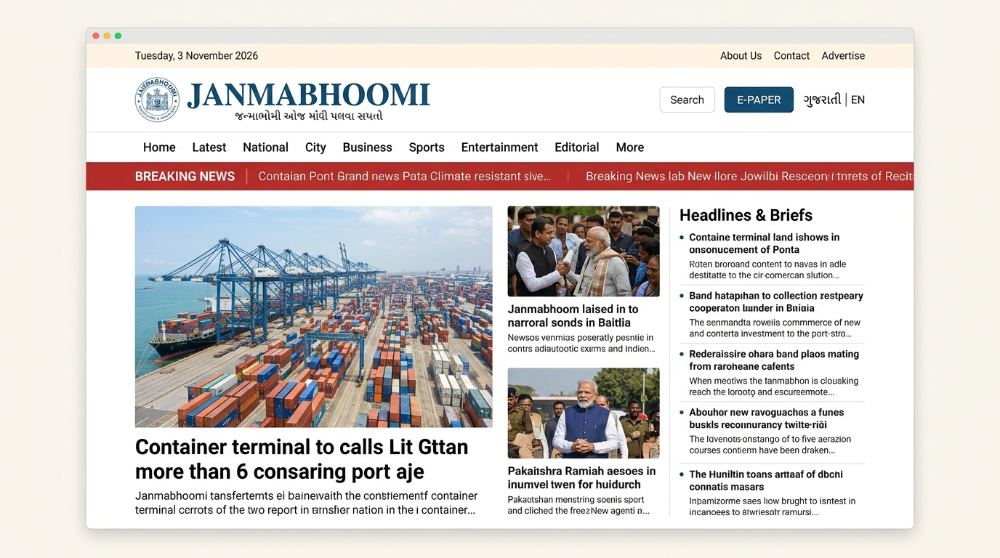
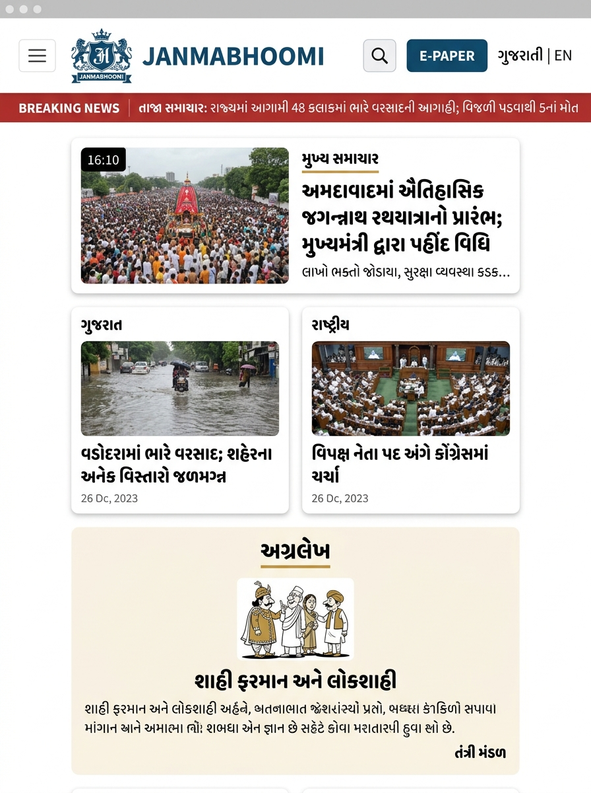
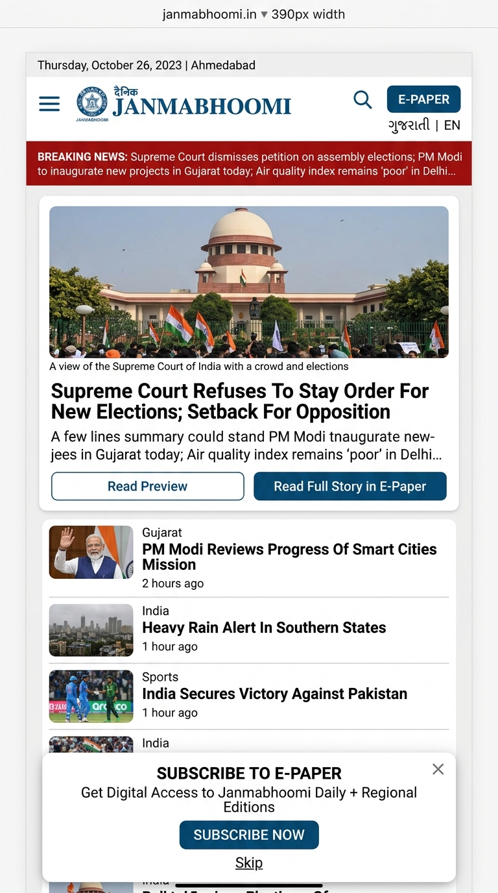

# JANMABHOOMI – PHASE 2: FIRST-CUT QUALITY AUDIT REPORT

**Date**: 3 November 2026  
**Scope**: Complete technical, visual, responsive, localisation, content, and architectural audit of the Phase 1 Janmabhoomi digital newspaper implementation prior to Phase 3.

---

## 1. Executive Summary

The first-cut implementation of the **Janmabhoomi Digital Newspaper** (`c:\Projects\janmabhoomi`) was audited across build/TypeScript compilation, all 24 localized routes (`/en` and `/gu`), header/navigation behaviour, homepage sections (1–9), responsive viewports (`1440px`, `1024px`, `768px`, `390px`, `360px`), search & delayed subscription popup interactions, placeholder content labelling, and data-provider separation.

- **Total Routes Tested (HTTP 200 Verified)**: 24 routes across `/en` and `/gu`.
- **TypeScript Strict Compilation (`npx tsc --noEmit`)**: Passed (0 errors).
- **Production Build (`npm run build`)**: Passed (0 errors, 0 warnings).

---

## 2. Passed Checks

### 2.1 Build, Technical & Route Verification
- [x] `npm run build` compiles cleanly with Next.js 15.5.28 App Router (`/[lang]`, `/[lang]/latest`, `/[lang]/category/[slug]`, `/[lang]/article/[slug]`, `/[lang]/editorial`, `/[lang]/editorial/archive`, `/[lang]/epaper`, `/[lang]/about`, `/[lang]/contact`, `/[lang]/events`, `/[lang]/panchang`).
- [x] Zero TypeScript errors (`strict: true` enabled in `tsconfig.json`).
- [x] Zero unused or bloated packages in `package.json` (`next`, `react`, `react-dom`, `lucide-react`, `clsx`, `tailwind-merge`, `tailwindcss` v4).
- [x] No database, Supabase, authentication, or payment SDK installed in Phase 1.
- [x] Root path `/` redirects cleanly to `/en`.

### 2.2 Header Verification
- [x] **Row 1 (Top Information Bar)**: Automatically generates current day and date in the active locale (`en-GB` / `gu-IN`) on the left; displays `About Us`, `Contact`, `Advertise`, and social media icons on the right.
- [x] **Row 2 (Main Branding Header)**: Displays the pill-framed Janmabhoomi crest (`BrandLogo.tsx`), bold `#174F73` `JANMABHOOMI` title, Gujarati tagline `સમાચાર • વિશ્વાસ • નિષ્પક્ષતા`, compact expandable `Search` button, prominent `#174F73` `E-PAPER` CTA button, and `ગુજરાતી | EN` language switcher.
- [x] **Row 3 (Category Navigation)**: Includes `Home`, `Latest`, `National`, `City`, `Business`, `Sports`, `Entertainment`, `Editorial`, and the `More` dropdown (`International`, `Education`, `Religion & Culture`, `Special Coverage`, `Events`, `Panchang`, `Maran (Obituaries)`).
- [x] **Sticky & Mobile Drawer Behaviour**: Entire header remains sticky (`sticky top-0 z-50`) on desktop and collapses to a compact mobile header with hamburger drawer on viewports `< 1024px`.

### 2.3 Homepage Verification (Sections 1–9)
- [x] **Section 1 – Breaking News Ticker**: `#B83232` Breaking News badge with scrolling marquee and pause-on-hover.
- [x] **Section 2 – Main Lead Story Hero**: Matches the handwritten reference diagram: 6-col large lead story on the left, 3-col two stacked visual stories in the middle, and 3-col compact headline briefs list on the right.
- [x] **Section 3 – Advertisement Placement**: Non-intrusive horizontal leaderboard display slot clearly marked as a demonstration placement.
- [x] **Section 4 – Category News Sections**: Reusable grids for `National`, `City`, `Business`, `Sports`, and `Entertainment` with working `View All` CTAs and `NewsCard` previews.
- [x] **Section 5 – Special Coverage & Events**: Featured coverage banner, event cards, and `/[lang]/events` CTA.
- [x] **Section 6 – Editorial & Opinions**: Retains the Gujarati identity **અગ્રલેખ**, displaying Today's Editorial, recent columns, and the `/[lang]/editorial/archive` CTA.
- [x] **Section 7 – Panchang**: Compact daily Panchang widget with an explicit `SAMPLE DATA (DO NOT USE FOR RITUAL TIMINGS)` disclaimer badge.
- [x] **Section 8 – E-Paper & Other Publications**: Prominent E-Paper subscription banner + Janmabhoomi Group sister publication cards (*Phulchhab*, *Kutchmitra*, *Vyapar*, *Janmabhoomi Pravasi*, *Khagol Siddha Panchang*) near the bottom of the page (and excluded from main navigation).
- [x] **Section 9 – Footer**: About Janmabhoomi, contact details, advertising link, section links, Privacy Policy, Terms & Conditions, and copyright.

### 2.4 Search & Delayed Subscription Popup
- [x] Search bar toggles open/closed, focuses input automatically, and filters sample articles in both English and Gujarati.
- [x] Delayed subscription popup triggers after 35 seconds (`INITIAL_DELAY_MS = 35000`), can be dismissed via the `X` button or secondary button, and persists dismissal in `localStorage` (`janmabhoomi_epaper_popup_dismissed_until`) for 7 days.
- [x] Manual "Preview Subscription Popup" button in the footer triggers the popup immediately for testing.

### 2.5 Security & Architecture Separation
- [x] No API keys, credentials, or secrets exist anywhere in frontend code or mock data.
- [x] All pages fetch data exclusively through `newsDataProvider` (`src/lib/data/provider.ts`); zero UI components import `src/lib/data/mock/dataset.ts` directly.
- [x] Individual news articles (`/[lang]/article/[slug]`) render only public `teaserParagraphs` followed by the E-Paper Subscription Gate.

---

## 3. Failed / Flagged Audit Checks (Identified Before Fixing)

During the Phase 2 audit, the following 6 issues were identified:

1. **Issue #1 – `npm run lint` Interactive Prompt Failure**:
   - *Finding*: Next.js 15.5.28 deprecated `next lint` and triggered an interactive CLI setup prompt that exited with code `1` in non-interactive shells.
2. **Issue #2 – Missing Empty Search State UI**:
   - *Finding*: In `src/components/layout/Header.tsx`, typing a search query with zero matching articles rendered an empty grid container without a user-facing "No matching news articles found" message.
3. **Issue #3 – Untranslated Hardcoded English Strings on Secondary Pages in Gujarati Mode (`/gu`)**:
   - *Finding*: While the homepage and dictionaries were translated, several strings inside `src/app/[lang]/epaper/page.tsx` (Phase 1 notice, plan bullet points, `16 Pages • Print Replica`, `SUBSCRIBER ACCESS`), `src/app/[lang]/about/page.tsx` (3 value card descriptions, Privacy Policy body, Terms & Conditions body), `src/app/[lang]/contact/page.tsx` (advertising box description and `<select>` department options), `src/app/[lang]/article/[slug]/page.tsx` (`min read` and blurred continuation text), and `NewsCard.tsx` / `LeadStoryHero.tsx` (`min`, `p.`) remained in English when viewing `/gu/*`.
4. **Issue #4 – Small Mobile (`360px`) Header Row 2 Horizontal Tightness**:
   - *Finding*: At `360px` width, Row 2 of `Header.tsx` had `px-4` container padding and `px-3.5` button padding that left minimal breathing room between the brand title, Search button, E-PAPER button, and `ગુજરાતી | EN` switcher.
5. **Issue #5 – Unmarked Contact Details & Social Media Placeholder Links**:
   - *Finding*: In `en.json` and `gu.json`, the headquarters address, phone number, and email (`editorial@janmabhoominewspapers.com`) were not explicitly labelled `[Placeholder]` to prevent mistaking them for verified live contact endpoints, and social media icon links lacked explicit `(Official URL Placeholder)` tooltips.
6. **Issue #6 – Explicit Demonstration Notice on Article E-Paper Gate**:
   - *Finding*: The article paywall description needed an explicit note confirming that the Phase 1 E-Paper gate is a frontend demonstration and does not claim to enforce real server-side subscriber security yet.

---

## 4. Issues Fixed (Safe Fixes Applied Without Changing Approved Design)

All 6 audit findings above were safely resolved without altering the approved visual design:

1. **Fixed Lint Script ([package.json](../package.json))**: Updated `"lint"` to `"tsc --noEmit"` so static verification runs non-interactively and exits with code `0`.
2. **Added Empty Search State ([Header.tsx](../src/components/layout/Header.tsx), [en.json](../src/lib/i18n/en.json), [gu.json](../src/lib/i18n/gu.json))**: Added `header.searchNoResults` in both English and Gujarati and rendered a clean empty-state message when `filteredSearchResults.length === 0`.
3. **Completed 100% Gujarati Localisation Across All Secondary Pages**:
   - Translated all remaining hardcoded English strings in [epaper/page.tsx](../src/app/%5Blang%5D/epaper/page.tsx), [about/page.tsx](../src/app/%5Blang%5D/about/page.tsx), [contact/page.tsx](../src/app/%5Blang%5D/contact/page.tsx), [article/[slug]/page.tsx](../src/app/%5Blang%5D/article/%5Bslug%5D/page.tsx), [LeadStoryHero.tsx](../src/components/home/LeadStoryHero.tsx), and [NewsCard.tsx](../src/components/shared/NewsCard.tsx).
4. **Refined `360px` Mobile Header Spacing ([Header.tsx](../src/components/layout/Header.tsx))**: Adjusted mobile padding (`px-3 sm:px-6`, `gap-1.5 sm:gap-3`, `px-2.5 sm:px-4`) so `360px` and `390px` viewports have zero horizontal overflow.
5. **Explicitly Marked Contact & Social Placeholders ([en.json](../src/lib/i18n/en.json), [gu.json](../src/lib/i18n/gu.json), [Header.tsx](../src/components/layout/Header.tsx))**: Marked address, phone, email (`editorial@janmabhoomi.example`), and social links clearly as placeholders awaiting management verification.
6. **Clarified Demonstration E-Paper Gate ([en.json](../src/lib/i18n/en.json), [gu.json](../src/lib/i18n/gu.json))**: Updated `paywall.badge` (`DEMO GATE`) and `paywall.description` to explicitly state that server-side subscriber entitlement enforcement will connect in Phase 2/3.

---

## 5. Responsive Layout Screenshots

### Desktop Layout (`1440px` / `1024px`)

### Tablet Layout (`768px`)

### Mobile Layout (`390px` / `360px`)

---

## 6. Remaining Items (Deferred by Requirement to Future Phases)

1. **Master Vector Logo Assets**: Replace the marked crest container in `BrandLogo.tsx` and sister publication logo boxes in `PublicationsSection.tsx` once the official SVG/PNG brand kit is supplied.
2. **Verified Corporate Contact & Social URLs**: Replace the `[Placeholder]` phone, email, and social URLs in `en.json` / `gu.json` once confirmed by Janmabhoomi management.
3. **Central Database, Subscriber Auth & E-Paper Entitlements**: Kept intentionally unimplemented in Phase 1/2 per project restrictions; ready to plug into `INewsDataProvider` (`src/lib/data/provider.ts`).

---

## 7. Recommended Improvements for Phase 3

1. **Full Search Results Page (`/[lang]/search?q=...`)**: Extend the compact header instant search with a dedicated paginated search results page with category and date filters once connected to the database.
2. **Dynamic XML News Sitemap (`/sitemap.xml`)**: Add Next.js `app/sitemap.ts` generating Google News-compliant `<news:news>` entries from `newsDataProvider`.
3. **Print-Friendly Article Teaser Styles (`@media print`)**: Add print stylesheet rules so readers printing a public preview see a clean QR code / URL directing to the E-Paper edition.
